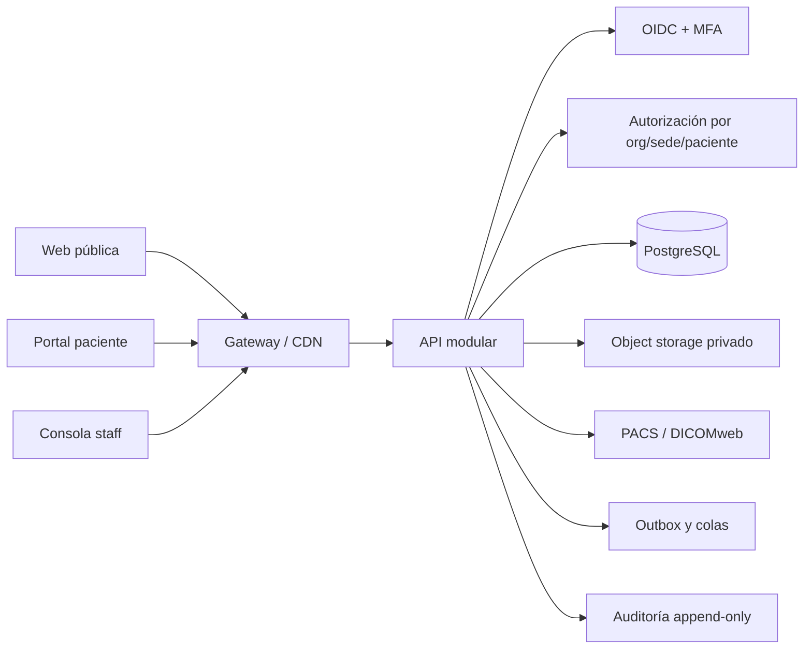

# Arquitectura objetivo recomendada

## Flujo de alto nivel

## Capas

### Frontend

Separar aplicaciones por superficie:

- web pública estática, sin PHI;
- portal paciente con sesión y permisos acotados;
- consola staff con permisos por rol, sede y relación asistencial;
- superadmin con acceso administrativo explícito y auditado.

Compartir un paquete de componentes, tokens, validaciones de formulario, cliente API y manejo de errores. Mantener una sola vista por módulo y controlar tema oscuro/claro mediante tokens.

### API y dominios

Usar un monolito modular con módulos de identidad, organizaciones, pacientes, agenda, encuentros, odontograma, tratamientos, documentos, imágenes, pagos, comunicaciones y auditoría. Cada módulo expone casos de uso y contratos; no modifica directamente tablas de otro módulo.

### Datos

Aplicar las decisiones descritas en [modelo de datos](../../docs/08-modelo-de-datos.md): PostgreSQL como fuente transaccional, `organization_id` en entidades de negocio, `site_id` cuando corresponda, UUID/ULID, `timestamptz`, importes enteros y registros clínicos versionados.

### Archivos

Guardar originales fuera de PostgreSQL. Usar carga temporal autorizada, cuarentena, verificación de MIME real, límite de tamaño, antivirus, limpieza de metadatos, derivadas para visualización y URLs firmadas de duración corta.

### Seguridad

El backend debe resolver la identidad a partir de la sesión y verificar permisos en cada operación. El cliente nunca debe decidir el tenant, paciente, precio, estado de pago, firma, rol ni auditoría.

### Offline

Usar Service Worker e IndexedDB únicamente para una cola de cambios explícita. Cada operación necesita idempotency key, versión de recurso, estado pendiente/confirmada/fallida, reintento limitado y resolución de conflicto.

## Decisiones que deben quedar documentadas

- proveedor de identidad y método MFA;
- matriz de roles, permisos y alcance por sede;
- política de acceso asistencial a pacientes;
- retención y exportación de historia clínica;
- clasificación de documentos e imágenes;
- estrategia de firma y validez de recetas;
- límites de carga, antivirus y recuperación;
- RPO/RTO, copias y pruebas de restauración;
- observabilidad sin escribir PHI en logs.
