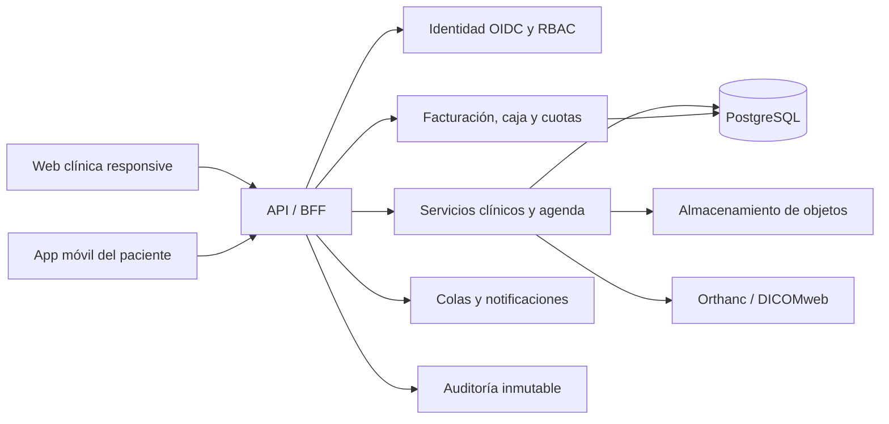

# Arquitectura, seguridad e interoperabilidad

## Arquitectura propuesta

Se recomienda comenzar como **monolito modular**, no como microservicios. Mantiene
transacciones coherentes y reduce operación, sin impedir separar imágenes,
notificaciones o interoperabilidad cuando la carga lo justifique.

## Módulos de dominio

- identidad, profesionales, roles y sedes;
- pacientes, apoderados y consentimientos;
- agenda y recursos clínicos;
- encuentros e historia clínica;
- odontograma y catálogo;
- plan de tratamiento y presupuesto;
- recetas e indicaciones;
- documentos, resultados e imágenes;
- caja, pagos, cuotas y comprobantes;
- notificaciones y preferencias;
- auditoría, exportación e interoperabilidad.

Cada módulo expone contratos y no modifica tablas ajenas de forma directa.

## Archivos y resultados clínicos

### Tipos

- informes PDF;
- notas de texto estructuradas;
- fotografías originales de alta resolución;
- PDF de radiografías;
- estudios DICOM cuando el equipo o proveedor los entregue;
- miniaturas y derivados para visualización.

### Canal de carga

1. el backend autoriza y crea una carga temporal;
2. el cliente sube por URL firmada de duración corta;
3. se verifica tamaño, MIME real, extensión y hash;
4. el archivo queda en cuarentena;
5. antivirus y validadores lo inspeccionan;
6. se extraen metadatos permitidos y se eliminan los innecesarios;
7. el objeto pasa a almacenamiento clínico;
8. se crea su referencia, versión y auditoría;
9. sólo se entrega con autorización y URL firmada breve.

No se servirán SVG/HTML subidos por usuarios ni se confiará en el nombre del archivo.
Los PDF se mostrarán en visor aislado y se conservará el original. En fotos, la versión
original no se reemplaza por la miniatura.

### Radiología

Un PDF de radiografía se trata como documento. Un estudio DICOM debe ir a PACS/Orthanc,
preservando estudio, serie, instancia y metadatos clínicos. La API puede mapearlo a
`ImagingStudy`; el informe asociado a `DiagnosticReport`/`DocumentReference`.

## Interoperabilidad

El modelo no necesita exponer FHIR completo en el MVP, pero debe prever equivalencias:

| Dominio interno | FHIR orientativo |
|---|---|
| paciente/apoderado | Patient, RelatedPerson |
| profesional y sede | Practitioner, PractitionerRole, Organization, Location |
| cita | Appointment, Schedule, Slot |
| atención | Encounter |
| condición/hallazgo | Condition, Observation |
| procedimiento | Procedure |
| plan | CarePlan, ServiceRequest |
| receta | MedicationRequest |
| resultado/documento/foto | DiagnosticReport, DocumentReference, Binary |
| radiología | ImagingStudy |
| trazabilidad | Provenance, AuditEvent |

FHIR es un contrato de intercambio, no sustituye las reglas locales ni el modelo
transaccional. Para archivos clínicos, `DocumentReference` permite indexar PDF, nota,
foto, audio o contenido binario; DICOMweb es preferible para imágenes DICOM.

## Recetas

Una receta debe guardar al menos paciente, prescriptor, colegiatura y habilitación cuando
corresponda, medicamento, forma/concentración, dosis, vía, frecuencia, duración,
indicaciones, fecha, vigencia y estado. Debe contemplar alergias, duplicidad y
contraindicaciones como alertas de apoyo, nunca como reemplazo del juicio profesional.

Estados: borrador, firmada/emitida, anulada y reemplazada. Una receta emitida no se edita:
se anula o reemplaza con trazabilidad. La firma digital con validez jurídica requiere
integración dentro de la Infraestructura Oficial de Firma Electrónica cuando sea
aplicable; una imagen pegada de firma no equivale a firma digital.

## Seguridad y privacidad

Los datos de salud son sensibles. El diseño debe alinearse con:

- Ley N.º 29733 y su nuevo Reglamento, DS N.º 016-2024-JUS, vigente desde el 31 de marzo
  de 2025;
- Ley N.º 30024 del Registro Nacional de Historias Clínicas Electrónicas y sus
  modificaciones, incluido el DS N.º 020-2025-SA;
- normativa de historia clínica, telesalud y firma digital aplicable;
- acuerdos, consentimientos y obligaciones contractuales concretas de la clínica.

Controles mínimos:

- MFA para personal y sesiones de riesgo;
- RBAC más reglas por sede, relación asistencial y paciente;
- cifrado TLS y cifrado de base/objetos/backups;
- llaves en un KMS o vault, separadas del código;
- auditoría de lectura, descarga, impresión y modificación;
- separación de ambientes y datos ficticios en pruebas;
- copias cifradas, restauraciones ensayadas y retención definida;
- rate limiting, protección CSRF/XSS/SQLi y cabeceras seguras;
- revisión de dependencias, secretos y contenedores;
- plan de incidentes, revocación de sesiones y borrado remoto;
- consentimiento y preferencias por canal de notificación;
- minimización de PHI en logs, analítica y mensajería.

Las notificaciones push/SMS/WhatsApp no deben revelar diagnóstico, tratamiento o saldo
en la pantalla bloqueada. Deben decir, por ejemplo, “tiene una actualización disponible”
y llevar al usuario autenticado.

## Trazabilidad

La auditoría registra quién, qué, cuándo, desde dónde lógico, paciente afectado, motivo,
valor anterior/nuevo o referencia al evento, y correlación de solicitud. Debe ser
append-only y contar con controles contra alteración. El acceso extraordinario
“break-glass” requiere motivo y revisión posterior.

## Fuentes

- [Nuevo Reglamento de Protección de Datos Personales](https://www.gob.pe/institucion/anpd/campa%C3%B1as/128319-nuevo-reglamento-de-proteccion-de-datos-personales)
- [DS N.º 020-2025-SA sobre la Ley 30024](https://www.gob.pe/institucion/minsa/normas-legales/7479922-020-2025-sa)
- [Firma digital en Perú](https://www.gob.pe/firmadigital)
- [NTS de Telesalud 235-MINSA/DIGTEL/2025](https://www.gob.pe/institucion/minsa/noticias/1260833-minsa-garantiza-atencion-a-distancia-a-traves-de-telesalud-con-publicacion-de-nueva-norma-tecnica)
- [FHIR DocumentReference](https://hl7.org/fhir/R5/documentreference.html)
- [FHIR MedicationRequest](https://hl7.org/fhir/R5/medicationrequest.html)
