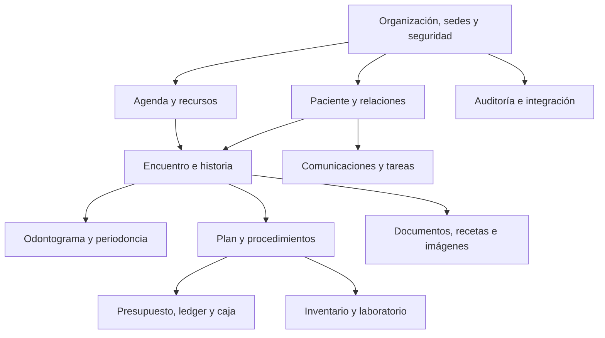

# Modelo de datos escalable

## Decisiones fundamentales

1. PostgreSQL como fuente transaccional.
2. IDs UUIDv7 o ULID generados por la aplicación; identificadores humanos separados.
3. `organization_id` en toda entidad de negocio para aislamiento multiempresa.
4. `site_id` cuando el dato pertenece a una sede; la primera versión opera una sola
   sede, pero no asume una sola sede en el esquema.
5. tiempos en UTC (`timestamptz`) y zona IANA configurada por sede.
6. importes como `bigint` en unidades menores más código ISO de moneda.
7. catálogos versionados; evitar enums de base de datos para estados que evolucionarán.
8. registros clínicos firmados y libros financieros append-only.
9. archivos fuera de PostgreSQL; guardar metadatos, hash y claves de objeto.
10. proyecciones y caches pueden reconstruirse desde fuentes autoritativas.

## Contextos delimitados



Cada contexto tiene su propio esquema lógico y servicios. Las referencias entre contextos
usan IDs y contratos; no se permiten actualizaciones casuales cruzadas.

## Tablas nucleares

### Organización y acceso

| Tabla | Propósito |
|---|---|
| `organizations` | clínica/tenant |
| `sites` | sedes con zona horaria y configuración |
| `users` | identidad de acceso, sin duplicar perfil clínico |
| `persons` | identidad humana base |
| `practitioners` | profesional y datos colegiados |
| `practitioner_sites` | vínculo, especialidad y vigencia por sede |
| `roles`, `permissions`, `role_permissions` | RBAC |
| `user_role_assignments` | rol con alcance organización/sede y vigencia |
| `access_policies` | reglas adicionales de relación asistencial |

`users`, `persons`, `patients` y `practitioners` son conceptos distintos. Una misma
persona puede ser usuario, profesional y paciente sin duplicar identidad.

### Paciente

| Tabla | Propósito |
|---|---|
| `patients` | identidad clínica dentro de organización |
| `patient_identifiers` | DNI, CE, historia interna; tipo/issuer/version |
| `patient_contacts` | teléfono, correo, dirección, preferencia y verificación |
| `patient_relationships` | apoderado, dependiente, contacto, vigencia y alcance |
| `patient_consents` | finalidad, documento/version, estado y evidencia |
| `patient_flags` | alertas no diagnósticas con visibilidad y vigencia |
| `patient_merge_records` | fusiones auditadas y paciente canónico |

Restricción recomendada: unicidad parcial por organización, sistema emisor, tipo y valor
normalizado del identificador. Los posibles duplicados van a revisión.

### Agenda

| Tabla | Propósito |
|---|---|
| `schedule_resources` | profesional, sillón, equipo, sala |
| `resource_availability_rules` | horarios recurrentes |
| `resource_blocks` | vacaciones, mantenimiento y bloqueos |
| `appointment_types` | duración, buffers y recursos requeridos |
| `appointments` | agregado principal y estado actual |
| `appointment_participants` | paciente, profesional, acompañante |
| `appointment_resource_bookings` | rangos reservados por recurso |
| `appointment_status_history` | transiciones y motivos |
| `waitlist_entries`, `slot_offers` | lista de espera y ofertas con expiración |

Usar rangos `tstzrange` y una exclusion constraint GiST por recurso para impedir
solapamientos en estados que ocupan agenda. No confiar sólo en una consulta previa.

### Encuentro e historia

| Tabla | Propósito |
|---|---|
| `encounters` | atención, sede, responsables, inicio/cierre |
| `clinical_note_versions` | notas versionadas y firmadas |
| `medical_history_versions` | antecedentes/anamnesis por versión |
| `allergies` | sustancia, reacción, certeza, estado |
| `conditions` | problema/diagnóstico codificado |
| `observations` | mediciones y hallazgos generales |
| `clinical_signatures` | firmante, hash, método, certificado/evidencia |
| `clinical_amendments` | corrección enlazada, motivo y autorización |

Las tablas firmadas no reciben `UPDATE` de contenido. Su estado puede cambiar mediante
una transición controlada o se agrega una versión/adenda.

### Odontograma y especialidades

| Tabla | Propósito |
|---|---|
| `dental_catalog_versions` | edición normativa/local del catálogo |
| `dental_concepts` | hallazgos, condiciones y procedimientos |
| `dental_concept_rules` | pieza/superficie/geometría y compatibilidad |
| `odontogram_sessions` | inicial, evolución o revisión |
| `odontogram_events` | marca clínica append-only |
| `odontogram_event_surfaces` | superficies N/M/D/V/L/O, etc. |
| `odontogram_snapshots` | proyección firmada y exportable |
| `periodontal_exams` | sesión de medición |
| `periodontal_sites` | pieza, sitio y medidas clínicas |
| `orthodontic_cases` | episodio ortodóntico |
| `orthodontic_visits` | controles y aparatos |

No crear columnas como `tooth_11_status ... tooth_48_status`. Pieza FDI y superficie son
datos, no estructura de tabla.

### Plan y ejecución

| Tabla | Propósito |
|---|---|
| `care_plans` | identidad longitudinal del plan |
| `care_plan_versions` | propuesta congelada por versión |
| `care_plan_items` | procedimiento, prioridad, pieza/superficie y estado |
| `plan_alternatives` | opciones mutuamente comparables |
| `plan_acceptances` | aceptación/rechazo y evidencia |
| `procedure_catalog` | catálogo clínico y administrativo versionado |
| `performed_procedures` | ejecución real |
| `procedure_tooth_sites` | localización dental de la ejecución |

Un `care_plan_item` nunca se convierte en procedimiento ejecutado modificando su tipo:
se crea `performed_procedure` y se relaciona con el ítem original.

### Documentos, recetas e imágenes

| Tabla | Propósito |
|---|---|
| `binary_objects` | hash, tamaño, MIME, bucket/key, cifrado y cuarentena |
| `document_records` | metadatos clínicos y visibilidad |
| `document_versions` | original y correcciones |
| `document_links` | relación polimórfica controlada a encuentro/procedimiento/pieza |
| `medication_requests` | receta e identidad de su cadena |
| `medication_request_versions` | contenido emitido por versión |
| `imaging_studies` | estudio DICOM |
| `imaging_series` | serie |
| `imaging_instances` | SOP Instance y referencia PACS |
| `diagnostic_reports` | informe de un estudio/resultado |

Evitar una tabla genérica `attachments(entity_type, entity_id)` sin integridad. Usar
tablas de enlace permitidas o un registro de recursos con validación estricta.

### Finanzas

| Tabla | Propósito |
|---|---|
| `price_books`, `price_book_versions`, `prices` | precios por sede/vigencia |
| `estimates`, `estimate_versions`, `estimate_lines` | presupuesto reproducible |
| `charges` | obligación generada |
| `payment_plans`, `installments` | acuerdo y vencimientos |
| `payments` | recepción de dinero e idempotencia |
| `payment_tenders` | efectivo/tarjeta/transferencia combinados |
| `payment_allocations` | aplicación a cargos/cuotas |
| `credits` | adelantos y saldos a favor |
| `refunds` | devolución enlazada |
| `ledger_entries` | libro de doble partida o movimientos balanceados |
| `cash_sessions`, `cash_movements` | apertura/cierre y caja física |
| `invoices`, `invoice_lines` | documento comercial |
| `provider_compensation_rules` | regla versionada de comisión |
| `provider_settlements` | liquidación calculada y aprobada |

El ledger es la fuente financiera. Los campos de saldo son proyecciones optimizadas,
recalculables y acompañadas de controles de consistencia.

### Operación y comunicación

| Tabla | Propósito |
|---|---|
| `inventory_items`, `stock_locations` | catálogo y almacenes |
| `stock_lots` | lote, costo y caducidad |
| `stock_movements` | entradas, consumos, ajustes y transferencias |
| `lab_cases`, `lab_case_events` | trabajos y estados |
| `communication_preferences` | finalidad × canal |
| `message_templates`, `template_versions` | plantillas versionadas |
| `message_dispatches`, `delivery_attempts` | envío y entrega |
| `conversation_threads`, `inbound_messages` | mensajería bidireccional |
| `tasks`, `task_events` | trabajo humano/automático |

### Extensiones reservadas de IA y voz

Estas tablas forman parte del diseño lógico, pero no participan en funcionalidades
activas ni se exponen a usuarios en el primer alcance.

| Tabla | Propósito futuro |
|---|---|
| `ai_use_case_definitions` | caso permitido, versión, riesgo y aprobación |
| `ai_provider_configs` | referencia segura al proveedor/modelo, nunca secretos planos |
| `ai_processing_consents` | base/consentimiento por finalidad y vigencia |
| `ai_jobs` | solicitud asíncrona con estado y correlación |
| `ai_input_references` | referencias autorizadas a datos de entrada |
| `ai_artifacts` | salida propuesta, modelo, versión y hash |
| `ai_human_reviews` | aceptación, rechazo, edición y responsable |
| `voice_recordings` | metadatos y objeto cifrado con retención |
| `voice_transcript_versions` | transcripción provisional/final y revisión |
| `ai_safety_events` | bloqueo, fuga potencial, contenido inválido o incidente |

Reglas futuras ya fijadas:

- una salida de IA nunca será el registro clínico oficial;
- sólo una aprobación humana crea una nota, hallazgo o acción de negocio;
- los datos enviados se registran por referencia y finalidad;
- modelo, versión, prompt/configuración, salida y revisión son trazables;
- la configuración permanecerá detrás de feature flags y permisos inexistentes en el
  primer despliegue.

## Columnas transversales

En entidades mutables:

```text
id
organization_id
created_at, created_by
updated_at, updated_by
version                 -- optimistic locking
```

Cuando corresponda:

```text
site_id
status_code
effective_from, effective_to
deleted_at              -- sólo entidades no clínicas/no financieras
external_system, external_id
correlation_id
```

No usar soft delete como solución universal. Historia clínica, auditoría y finanzas se
anulan/corrigen; catálogos administrativos pueden archivarse.

## Eventos e integraciones

Una tabla `outbox_events` participa en la misma transacción que el agregado. Un worker
publica eventos idempotentes, por ejemplo:

- `appointment.confirmed.v1`;
- `encounter.closed.v1`;
- `care-plan.accepted.v1`;
- `procedure.completed.v1`;
- `document.published.v1`;
- `payment.received.v1`;
- `installment.overdue.v1`.

Los consumidores registran `inbox_messages` o claves procesadas. Esto evita perder un
aviso o duplicar un pago por reintentos.

## Particionamiento e índices

No particionar prematuramente todas las tablas. Candidatas al crecer:

- `audit_events` por mes y/o organización;
- `message_dispatches` por fecha;
- `odontogram_events` y `observations` si el volumen lo justifica;
- metadatos de imágenes, manteniendo binarios en objeto/PACS.

Índices mínimos deben seguir consultas reales:

- paciente por identificador y nombre normalizado;
- citas por sede/recurso/rango/estado;
- encuentros y documentos por paciente/fecha;
- cuotas por estado/vencimiento;
- pagos por proveedor/referencia/idempotencia;
- auditoría por organización, paciente, actor y momento.

## Multi-tenancy

Primera opción: base compartida y esquema compartido con `organization_id`, Row Level
Security, claves compuestas y pruebas automatizadas de aislamiento. Para clientes que lo
exijan, admitir posteriormente base dedicada mediante la misma capa de repositorios.

Nunca aceptar `organization_id` directamente del cliente como autorización; se deriva
de la sesión y pertenencia activa.

## Multisede diseñada pero no implementada

La organización inicial tendrá una sede predeterminada creada durante el onboarding.
Todas las escrituras recibirán su `site_id` desde el contexto del servidor. La interfaz
no permitirá crear otra sede ni cambiar de sede.

El diseño reserva:

- pertenencia de profesionales y usuarios por sede;
- recursos, precios, almacenes, cajas, documentos y numeración por sede;
- políticas con alcance organización/sede;
- claves únicas compuestas con `organization_id` y `site_id`;
- eventos que incluyen sede de origen;
- tablas de transferencia y consolidación que se activarán sólo al implementar el módulo.

Esto evita una migración estructural futura, sin fingir que la operación multisede ya
está resuelta.

## Migraciones y evolución

- migraciones expand/contract compatibles con versiones anteriores;
- cambios destructivos en dos o más despliegues;
- datos históricos conservan versión de catálogo y regla aplicada;
- APIs y eventos versionados;
- backfills reanudables e idempotentes;
- pruebas con volumen, concurrencia y restauración;
- diccionario de datos y ADR para decisiones estructurales.

## Orden de diseño

1. validar casos críticos y reglas;
2. dibujar agregados y límites transaccionales;
3. definir identificadores y eventos;
4. modelar tablas normalizadas;
5. definir restricciones e índices;
6. diseñar API y permisos;
7. crear pruebas de invariantes;
8. recién entonces construir pantallas.

## Invariantes que la base debe proteger

- no hay dos reservas activas solapadas para el mismo recurso;
- un odontograma inicial firmado no cambia;
- un plan propuesto no equivale a un procedimiento ejecutado;
- ninguna versión firmada pierde su contenido anterior;
- asignaciones de un pago no superan el importe disponible;
- un asiento financiero balancea;
- un webhook con igual clave no crea otro pago;
- una persona ajena a la organización no puede relacionarse por un ID adivinado;
- un archivo en cuarentena no puede publicarse;
- toda publicación clínica al paciente tiene autor y momento.
