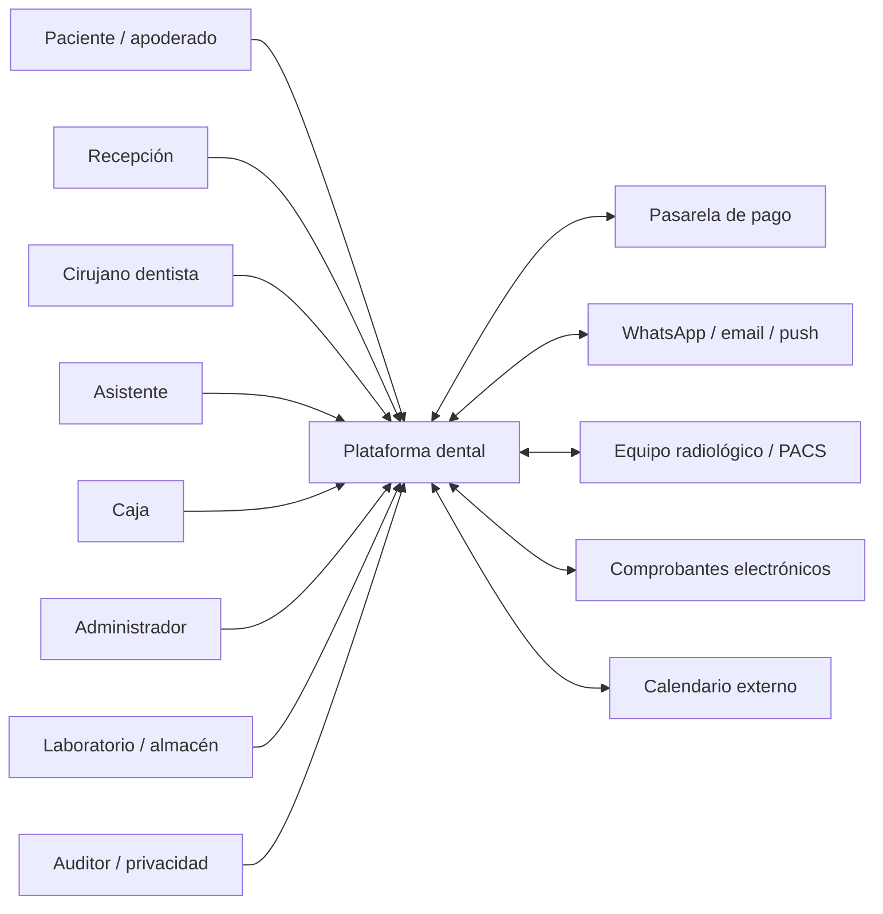
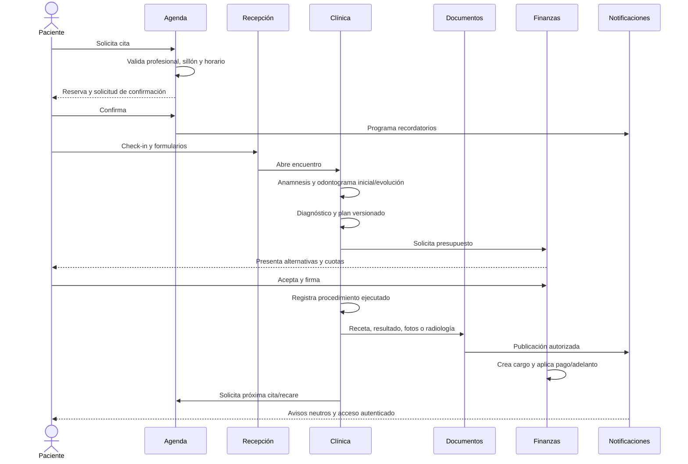
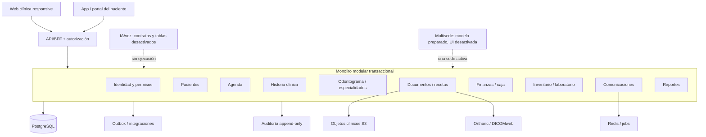
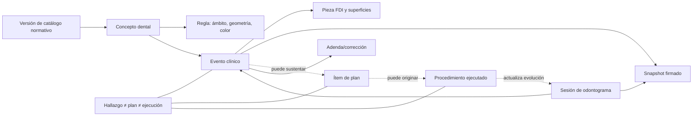
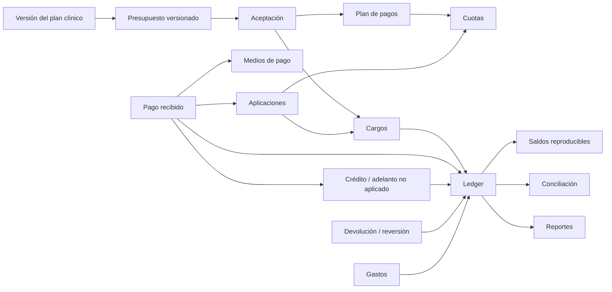
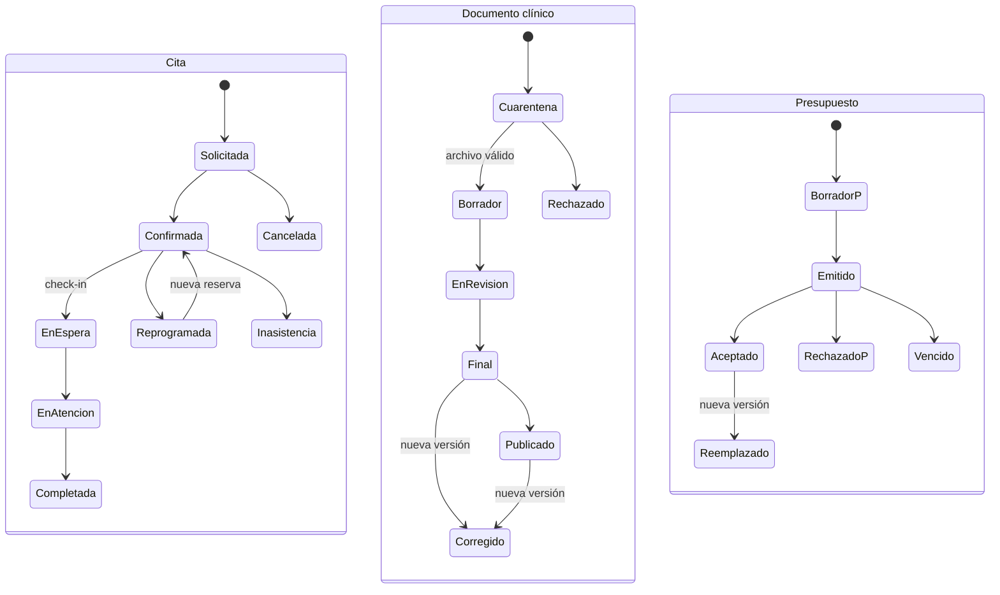
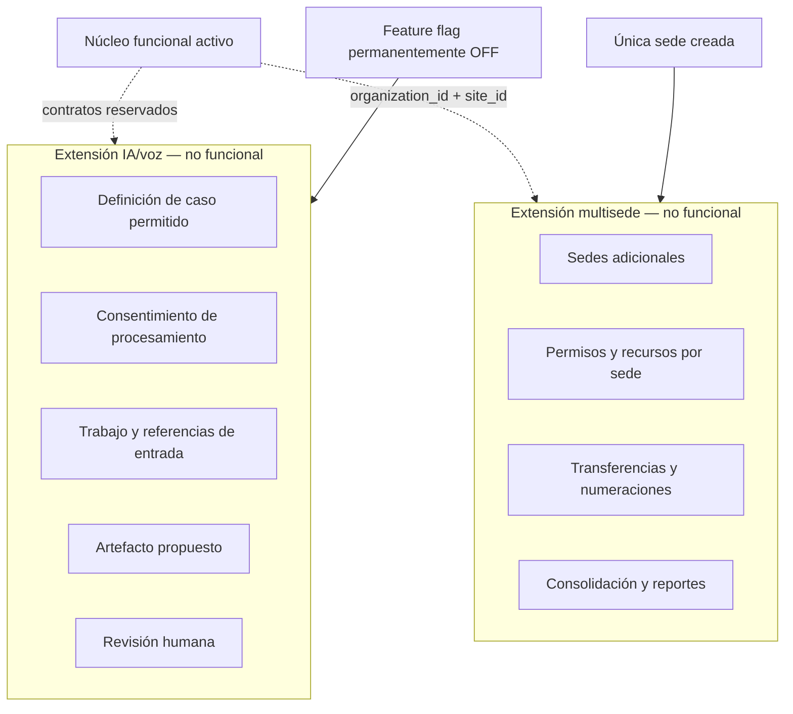
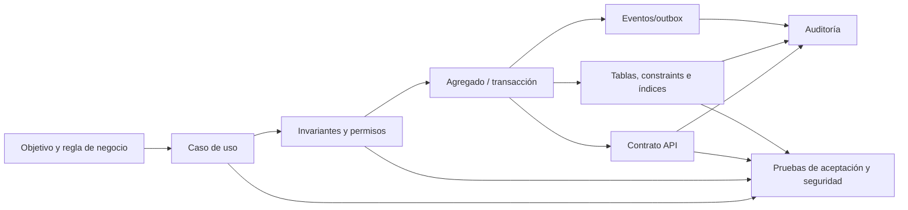

# Diagramas integrales de la solución

## 1. Contexto y actores

## 2. Casos de uso principales

```mermaid
flowchart TB
  PAC["Paciente"]
  REC["Recepción"]
  PRO["Profesional"]
  CAJ["Caja"]
  OPE["Operación"]
  ADM["Administrador"]

  subgraph IDENTIDAD["Paciente e identidad"]
    U1["Registrar / buscar / fusionar"]
    U2["Apoderados y consentimientos"]
    U3["Antecedentes y alertas"]
  end

  subgraph AGENDA["Agenda y recepción"]
    U4["Buscar y reservar slot"]
    U5["Confirmar / reprogramar / cancelar"]
    U6["Lista de espera y check-in"]
  end

  subgraph CLINICA["Atención clínica"]
    U7["Abrir y cerrar encuentro"]
    U8["Odontograma y periodontograma"]
    U9["Diagnóstico y plan"]
    U10["Procedimiento y evolución"]
    U11["Receta, documento e imagen"]
  end

  subgraph FINANZAS["Presupuesto y finanzas"]
    U12["Cotizar y aceptar"]
    U13["Cuotas y adelantos"]
    U14["Cobrar, aplicar y conciliar"]
    U15["Caja, gastos y comisiones"]
  end

  subgraph OPERACION["Operación y crecimiento"]
    U16["Inventario y lotes"]
    U17["Casos de laboratorio"]
    U18["Mensajería, recare y encuestas"]
    U19["Analítica y auditoría"]
  end

  PAC --> U2
  PAC --> U4
  PAC --> U5
  PAC --> U12
  PAC --> U13
  PAC --> U18

  REC --> U1
  REC --> U2
  REC --> U4
  REC --> U5
  REC --> U6

  PRO --> U3
  PRO --> U7
  PRO --> U8
  PRO --> U9
  PRO --> U10
  PRO --> U11
  PRO --> U12

  CAJ --> U13
  CAJ --> U14
  CAJ --> U15

  OPE --> U16
  OPE --> U17

  ADM --> U15
  ADM --> U19
```

## 3. Flujo de atención de extremo a extremo

## 4. Arquitectura funcional

## 5. Modelo entidad-relación conceptual

```mermaid
erDiagram
  ORGANIZATION ||--o{ SITE : contiene
  ORGANIZATION ||--o{ USER : autoriza
  PERSON ||--o| USER : accede_como
  PERSON ||--o| PATIENT : es
  PERSON ||--o| PRACTITIONER : ejerce_como
  PRACTITIONER ||--o{ PRACTITIONER_SITE : pertenece
  SITE ||--o{ PRACTITIONER_SITE : asigna

  PATIENT ||--o{ PATIENT_IDENTIFIER : identifica
  PATIENT ||--o{ PATIENT_RELATIONSHIP : vincula
  PATIENT ||--o{ PATIENT_CONSENT : otorga

  SITE ||--o{ SCHEDULE_RESOURCE : posee
  APPOINTMENT ||--o{ APPOINTMENT_RESOURCE_BOOKING : reserva
  SCHEDULE_RESOURCE ||--o{ APPOINTMENT_RESOURCE_BOOKING : ocupa
  PATIENT ||--o{ APPOINTMENT : agenda
  APPOINTMENT ||--o| ENCOUNTER : origina

  PATIENT ||--o{ ENCOUNTER : recibe
  PRACTITIONER ||--o{ ENCOUNTER : atiende
  ENCOUNTER ||--o{ CLINICAL_NOTE_VERSION : documenta
  ENCOUNTER ||--o{ ODONTOGRAM_SESSION : contiene
  ODONTOGRAM_SESSION ||--o{ ODONTOGRAM_EVENT : registra
  DENTAL_CONCEPT ||--o{ ODONTOGRAM_EVENT : clasifica

  PATIENT ||--o{ CARE_PLAN : posee
  CARE_PLAN ||--o{ CARE_PLAN_VERSION : versiona
  CARE_PLAN_VERSION ||--o{ CARE_PLAN_ITEM : propone
  CARE_PLAN_ITEM ||--o{ PERFORMED_PROCEDURE : origina
  ENCOUNTER ||--o{ PERFORMED_PROCEDURE : ejecuta

  PATIENT ||--o{ DOCUMENT_RECORD : posee
  DOCUMENT_RECORD ||--o{ DOCUMENT_VERSION : versiona
  DOCUMENT_VERSION }o--|| BINARY_OBJECT : almacena
  PATIENT ||--o{ MEDICATION_REQUEST : recibe
  PATIENT ||--o{ IMAGING_STUDY : posee
  IMAGING_STUDY ||--o{ DIAGNOSTIC_REPORT : informa

  CARE_PLAN_VERSION ||--o{ ESTIMATE_VERSION : cotiza
  ESTIMATE_VERSION ||--o{ ESTIMATE_LINE : detalla
  PATIENT ||--o{ CHARGE : adeuda
  PATIENT ||--o{ PAYMENT : paga
  PAYMENT ||--o{ PAYMENT_TENDER : divide
  PAYMENT ||--o{ PAYMENT_ALLOCATION : aplica
  CHARGE ||--o{ PAYMENT_ALLOCATION : recibe
  PAYMENT_PLAN ||--o{ INSTALLMENT : programa

  SITE ||--o{ STOCK_LOCATION : posee
  INVENTORY_ITEM ||--o{ STOCK_LOT : agrupa
  STOCK_LOT ||--o{ STOCK_MOVEMENT : mueve
  PATIENT ||--o{ LAB_CASE : requiere
  LAB_CASE ||--o{ LAB_CASE_EVENT : evoluciona
```

## 6. Relaciones clínicas del odontograma

## 7. Relaciones financieras

## 8. Estados principales

## 9. IA/voz y multisede como extensiones apagadas

## 10. Trazabilidad desde requerimiento hasta datos

