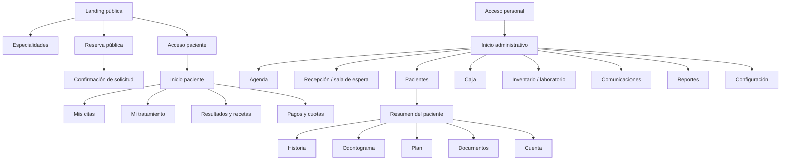
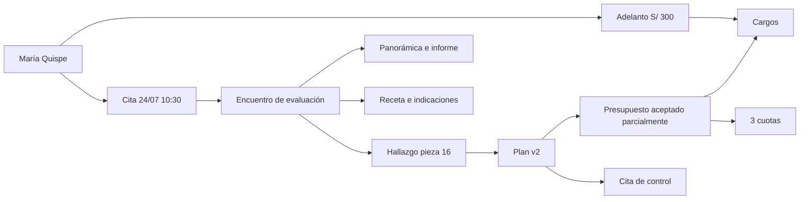

# Plan de vistas HTML y datos seed para el mockup

## 1. Propósito

Construir un prototipo HTML navegable de alta fidelidad que permita presentar y validar:

- la landing pública de una clínica dental especializada en Arequipa;
- la reserva y experiencia digital del paciente;
- la operación diaria de recepción;
- la atención clínica y el odontograma;
- presupuestos, pagos, cuotas y caja;
- documentos, fotografías y radiología;
- periodoncia, ortodoncia, implantes y laboratorio;
- inventario, comisiones, reportes y configuración;
- la arquitectura preparada para multisede e IA/voz, sin mostrarlas como funcionales.

El prototipo será un mockup: no tendrá backend, autenticación real, pagos reales,
persistencia clínica ni procesamiento de archivos. Las interacciones se simularán con
JavaScript local y un conjunto único de datos ficticios.

## Implementación entregada en `prototype/`

Para que el mockup pueda abrirse sin bundler ni backend, la primera entrega consolida las
vistas protegidas en dos entradas navegables con query params, manteniendo la misma
separación conceptual del plan:

- `index.html` y `reservar.html` cubren la superficie pública y el flujo de reserva;
- `paciente.html?view=...` cubre inicio, citas, tratamiento, documentos y pagos;
- `admin.html?view=...` cubre tablero, agenda, recepción, pacientes, historia clínica,
  odontograma, periodoncia, ortodoncia, plan, documentos, recetas, cuenta, finanzas,
  operación, comunicación, reportes, auditoría y configuración.

La consolidación es sólo una decisión de navegación del prototipo. En la implementación
real cada vista se separará en una ruta protegida, permisos y API propios. El inventario
de vistas, reglas y estados de este documento sigue siendo la fuente de alcance.

## 2. Objetivos de validación

El mockup debe responder visualmente estas preguntas:

1. ¿Un paciente entiende la propuesta de valor y puede solicitar una cita?
2. ¿Recepción puede comprender el día de trabajo en menos de un minuto?
3. ¿El profesional puede registrar un hallazgo sin confundirlo con un tratamiento?
4. ¿El plan clínico se conecta de forma comprensible con presupuesto y cuotas?
5. ¿Los documentos y radiografías se encuentran dentro del contexto del paciente?
6. ¿Cada saldo puede explicarse por cargos, pagos, adelantos y aplicaciones?
7. ¿La experiencia funciona en escritorio, tablet y móvil?
8. ¿La presentación parece un producto coherente y no una colección de plantillas?

## 3. Identidad ficticia de la clínica

Todos los nombres, teléfonos, documentos, historias y operaciones serán ficticios.

### Marca

**Nombre:** Sillar Dental Especialidades  
**Descriptor:** Clínica dental especializada en Arequipa  
**Promesa:** Diagnóstico claro, tratamiento planificado y seguimiento cercano.  
**Ubicación ficticia:** Av. Los Arces 418, Yanahuara, Arequipa  
**Teléfono ficticio:** +51 954 000 418  
**Correo ficticio:** citas@sillardental.demo  
**Horario:** lunes a sábado, 8:00 a. m. a 8:00 p. m.

### Personalidad visual

- profesional, serena y contemporánea;
- referencias sutiles al sillar y la luz de Arequipa, sin recurrir a clichés turísticos;
- fondos claros, superficies cálidas y contraste clínico;
- azul mineral como color de confianza;
- terracota suave como acento regional;
- verde controlado para estados positivos;
- rojo reservado para alertas y riesgos;
- iconografía lineal y fotografías con iluminación natural.

### Mensaje principal de landing

> Atención dental especializada con diagnóstico digital y un plan que puedes entender.

Texto complementario:

> Reunimos especialistas, imágenes clínicas, seguimiento y facilidades de pago en una
> experiencia coordinada para niños, jóvenes y adultos en Arequipa.

Acciones principales:

- `Reservar evaluación`
- `Escribir por WhatsApp`
- `Ver especialidades`

## 4. Arquitectura del prototipo

```text
prototype/
├── index.html                       Landing
├── reservar.html                    Reserva pública
├── especialidades/
│   ├── ortodoncia.html
│   ├── implantologia.html
│   ├── periodoncia.html
│   ├── endodoncia.html
│   └── odontopediatria.html
├── paciente/
│   ├── acceso.html
│   ├── inicio.html
│   ├── citas.html
│   ├── tratamiento.html
│   ├── documentos.html
│   ├── pagos.html
│   └── perfil.html
├── admin/
│   ├── acceso.html
│   ├── inicio.html
│   ├── agenda.html
│   ├── recepcion.html
│   ├── pacientes.html
│   ├── paciente-resumen.html
│   ├── paciente-historia.html
│   ├── paciente-odontograma.html
│   ├── paciente-periodoncia.html
│   ├── paciente-ortodoncia.html
│   ├── paciente-plan.html
│   ├── paciente-documentos.html
│   ├── paciente-recetas.html
│   ├── paciente-cuenta.html
│   ├── encuentro.html
│   ├── presupuesto.html
│   ├── caja.html
│   ├── pagos.html
│   ├── cobranza.html
│   ├── inventario.html
│   ├── laboratorio.html
│   ├── comisiones.html
│   ├── comunicaciones.html
│   ├── reportes.html
│   ├── auditoria.html
│   └── configuracion.html
├── assets/
│   ├── css/
│   │   ├── tokens.css
│   │   ├── base.css
│   │   ├── public.css
│   │   └── app.css
│   ├── js/
│   │   ├── seed.js
│   │   ├── mock-api.js
│   │   ├── public.js
│   │   └── app.js
│   ├── images/
│   │   └── dental-reference/        Material abierto de referencia
│   └── icons/
└── README.md
```

La estructura es una guía. Puede implementarse como HTML multipágina o con un router
ligero, pero cada URL debe funcionar directamente para facilitar demostraciones.

## 5. Mapa de navegación



## 6. Landing pública

### 6.1 Inicio — `index.html`

Secciones:

1. encabezado con logo, especialidades, equipo, tecnología, financiación y contacto;
2. hero con promesa, acciones y fotografía clínica;
3. franja de confianza: especialistas, atención integral, diagnóstico digital y pagos;
4. especialidades principales;
5. recorrido de atención en cuatro pasos;
6. bloque de odontología digital: imágenes, planificación y seguimiento;
7. presentación breve del equipo;
8. caso ilustrativo anonimizado con “evaluación → plan → seguimiento”;
9. facilidades de pago;
10. testimonios ficticios claramente marcados como contenido demostrativo;
11. preguntas frecuentes;
12. mapa esquemático y datos de contacto;
13. CTA final de reserva;
14. footer legal y acceso del paciente.

Estados simulados:

- navegación móvil;
- selector de especialidad;
- CTA sticky discreto en móvil;
- formulario de contacto con confirmación local;
- botón de WhatsApp sin abrir un número real en el prototipo.

### 6.2 Especialidad — `especialidades/*.html`

Plantilla reutilizable:

- problema/necesidad que atiende;
- especialistas relacionados;
- qué incluye la evaluación;
- proceso habitual;
- tecnologías utilizadas;
- preguntas frecuentes;
- casos en los que se requiere atención prioritaria;
- CTA para reservar.

No se publicarán precios cerrados para tratamientos que requieren diagnóstico. Puede
mostrarse el costo ficticio de evaluación con una etiqueta de demostración.

### 6.3 Reserva — `reservar.html`

Flujo por pasos:

1. especialidad o motivo;
2. primera visita/continuidad;
3. profesional opcional;
4. fecha y slot;
5. datos del paciente;
6. aceptación de privacidad y canal;
7. resumen y envío.

La reserva pública genera una **solicitud pendiente**, no una cita clínica confirmada
sin validación del recurso.

## 7. Portal del paciente

### 7.1 Acceso — `paciente/acceso.html`

- DNI/CE o correo;
- contraseña ficticia;
- recuperación simulada;
- aviso de privacidad;
- acceso demostrativo con la paciente seed `María Fernanda Quispe`.

### 7.2 Inicio — `paciente/inicio.html`

- próxima cita;
- acciones pendientes;
- nueva receta/resultado;
- avance del plan;
- próxima cuota y saldo;
- indicaciones postratamiento;
- acceso a dependiente cuando aplique.

### 7.3 Citas — `paciente/citas.html`

- próximas e históricas;
- detalle de sede, profesional, preparación y estado;
- confirmar, solicitar reprogramación o cancelar;
- añadir a calendario;
- ingreso a lista de espera.

### 7.4 Tratamiento — `paciente/tratamiento.html`

- explicación no técnica del plan vigente;
- alternativas y aceptación;
- línea de tiempo de procedimientos;
- presupuesto relacionado;
- documentos de consentimiento;
- próximas acciones.

No se mostrará el odontograma clínico editable. Puede existir una visualización
informativa de las piezas relacionadas con el plan.

### 7.5 Documentos — `paciente/documentos.html`

- resultados publicados;
- recetas vigentes y anuladas;
- indicaciones;
- fotografías compartidas;
- informe radiográfico;
- fecha, profesional, versión y descarga simulada.

### 7.6 Pagos — `paciente/pagos.html`

- resumen de presupuesto;
- cargos y aplicaciones;
- plan de cuotas;
- adelanto disponible;
- historial de pagos;
- botón de pago simulado;
- descarga de recibo/comprobante.

## 8. Shell de administración

Elementos persistentes:

- barra lateral colapsable;
- encabezado con búsqueda global;
- contexto de fecha y única sede;
- centro de tareas y alertas;
- perfil/rol;
- breadcrumb;
- área principal;
- panel lateral contextual opcional.

El selector multisede no aparece. Se muestra `Sillar Dental · Yanahuara` como contexto
fijo para demostrar que la sede forma parte del modelo.

Roles demostrables:

- recepción;
- cirujano dentista;
- caja;
- administrador.

Cambiar rol modifica acciones visibles, no los datos seed.

## 9. Vistas administrativas

### 9.1 Inicio — `admin/inicio.html`

Objetivo: reunión operativa de cinco minutos.

- citas de hoy y ocupación;
- pacientes por confirmar;
- sala de espera;
- tratamientos sin agendar;
- cuotas vencidas;
- documentos pendientes de revisión;
- stock crítico;
- casos de laboratorio próximos;
- producción y cobranza del día;
- tareas asignadas.

### 9.2 Agenda — `admin/agenda.html`

- vista diaria/semanal;
- columnas por profesional o sillón;
- filtros por especialidad, profesional, recurso y estado;
- bloque de citas y buffers;
- drag-and-drop simulado con validación;
- creación rápida;
- lista de espera;
- disponibilidad;
- bloqueos y vacaciones;
- panel de detalle.

Interacción crítica:

1. arrastrar la cita de María de 10:30 a 11:00;
2. mostrar conflicto con el sillón 2;
3. sugerir 11:30;
4. confirmar y añadir evento al historial local.

### 9.3 Recepción — `admin/recepcion.html`

Vista tipo cola:

- por confirmar;
- próximos;
- llegó;
- en espera;
- en atención;
- por cobrar;
- completado.

Acciones: check-in, verificar formulario, avisar profesional, pasar a caja y agendar
seguimiento.

### 9.4 Pacientes — `admin/pacientes.html`

- búsqueda por nombre, historia, documento o teléfono;
- filtros por estado, profesional y deuda;
- detección visual de posible duplicado;
- alta rápida;
- importación simulada;
- tabla y tarjetas adaptables a móvil.

### 9.5 Resumen del paciente — `admin/paciente-resumen.html`

Cabecera clínica persistente:

- nombre, edad, historia e identificador;
- alertas y alergias;
- saldo;
- próxima cita;
- profesional principal;
- acciones rápidas según rol.

Contenido:

- timeline;
- plan activo;
- últimos procedimientos;
- documentos recientes;
- citas;
- cuenta;
- tareas.

### 9.6 Historia — `admin/paciente-historia.html`

- antecedentes y versiones;
- alergias;
- medicamentos;
- diagnósticos;
- encuentros;
- notas firmadas;
- adendas;
- auditoría clínica resumida.

### 9.7 Odontograma — `admin/paciente-odontograma.html`

Diseño tablet-first:

- dentición permanente/temporal;
- SVG por pieza y superficie;
- paleta de hallazgos;
- paleta de plan separada;
- panel de detalle;
- timeline de evolución;
- leyenda normativa;
- comparación entre fechas;
- borrador, revisión y firma;
- exportación simulada.

Escenario seed:

- pieza 16: caries oclusal observada;
- pieza 26: restauración existente;
- pieza 36: endodoncia previa y corona;
- pieza 46: ausente;
- plan propuesto independiente para 16 y 46;
- procedimiento completado en pieza 11 dentro de un encuentro anterior.

### 9.8 Periodoncia — `admin/paciente-periodoncia.html`

- mediciones por seis sitios;
- sangrado, placa, movilidad, furca y recesión;
- entrada rápida por teclado;
- resumen gráfico;
- comparación de dos sesiones;
- firma y exportación.

No se simulará voz: puede aparecer una nota `Entrada por voz — función futura` en la
documentación técnica, pero no como control visible en la pantalla.

### 9.9 Ortodoncia — `admin/paciente-ortodoncia.html`

- datos del caso;
- diagnóstico y objetivos;
- aparatos;
- controles;
- fotografías;
- documentos;
- tareas de laboratorio;
- progreso y próxima cita.

### 9.10 Plan — `admin/paciente-plan.html`

- versión vigente;
- alternativas;
- prioridad y fases;
- piezas/superficies;
- procedimientos;
- estado: propuesto, aceptado, agendado, realizado;
- consentimiento;
- relación con presupuesto;
- tratamientos no agendados.

### 9.11 Documentos — `admin/paciente-documentos.html`

- zona de carga simulada;
- estados de cuarentena, revisión, final y publicado;
- foto, PDF e informe radiográfico;
- visor;
- metadatos;
- versión;
- permisos;
- publicar/revocar acceso del paciente;
- descarga auditada.

### 9.12 Recetas — `admin/paciente-recetas.html`

- crear borrador;
- medicamento y posología;
- alergias visibles;
- vista previa;
- firmar/emitir;
- anular y reemplazar;
- publicar al paciente;
- historial de versiones.

### 9.13 Cuenta — `admin/paciente-cuenta.html`

- presupuesto aceptado;
- cargos;
- cuotas;
- adelantos;
- pagos;
- aplicaciones;
- devoluciones;
- saldo;
- línea de tiempo financiera.

Debe ser posible seleccionar un pago y ver exactamente a qué cargos se aplicó.

### 9.14 Encuentro — `admin/encuentro.html`

Workbench clínico:

- motivo y alertas;
- anamnesis;
- odontograma;
- notas;
- procedimientos;
- fotos/documentos;
- receta;
- plan/próxima cita;
- controles de cierre.

El encuentro debe minimizar cambios de pantalla sin ocultar el contexto.

### 9.15 Presupuesto — `admin/presupuesto.html`

- versión del plan;
- precios y descuentos autorizados;
- alternativas;
- pago único;
- adelanto + saldo;
- cuotas iguales;
- cuotas personalizadas;
- vista del paciente;
- aceptación/firma;
- conversión a cargos.

### 9.16 Caja y pagos

`admin/caja.html`:

- apertura;
- saldo esperado;
- movimientos;
- ingresos y egresos;
- medios;
- cierre y diferencia.

`admin/pagos.html`:

- registro de pago;
- múltiples medios;
- aplicación a cargos;
- adelanto;
- recibo;
- devolución supervisada.

`admin/cobranza.html`:

- cuotas próximas y vencidas;
- promesas de pago;
- tareas;
- mensajes;
- filtros de mora;
- historial de contacto.

### 9.17 Inventario — `admin/inventario.html`

- stock actual;
- lotes y vencimientos;
- movimientos;
- mínimos;
- compra/entrada;
- consumo;
- ajuste con motivo;
- costo y proveedor;
- asociación con procedimientos.

### 9.18 Laboratorio — `admin/laboratorio.html`

- tablero por estado;
- paciente y trabajo;
- laboratorio externo;
- impresiones/archivos;
- fechas prometidas;
- costo;
- recepción, prueba y entrega;
- incidencias.

### 9.19 Comisiones — `admin/comisiones.html`

- reglas por procedimiento/profesional;
- periodo;
- producción elegible;
- ajustes;
- liquidación;
- aprobación;
- estado de pago;
- trazabilidad de cálculo.

### 9.20 Comunicaciones — `admin/comunicaciones.html`

- conversaciones de WhatsApp simuladas;
- recordatorios;
- confirmaciones;
- recare;
- presupuestos pendientes;
- cuidados postratamiento;
- preferencias y opt-out;
- plantillas versionadas;
- métricas de entrega.

### 9.21 Reportes — `admin/reportes.html`

Tabs:

- agenda;
- clínica;
- ventas/aceptación;
- finanzas;
- inventario/laboratorio;
- fidelización;
- calidad y seguridad.

Cada gráfico debe poder rastrearse hacia la lista que lo origina.

### 9.22 Auditoría — `admin/auditoria.html`

- actor;
- paciente;
- acción;
- módulo;
- fecha;
- resultado;
- IP/dispositivo simulados;
- razón de acceso extraordinario;
- detalle antes/después cuando corresponda.

### 9.23 Configuración — `admin/configuracion.html`

- datos de organización;
- sede única;
- profesionales;
- recursos;
- horarios;
- roles;
- catálogos;
- precios;
- plantillas;
- canales;
- políticas.

No incluir:

- creación de segunda sede;
- configuración de proveedores IA;
- activación de voz;
- feature flags técnicas.

## 10. Datos seed coherentes

### 10.1 Organización y sede

```js
const organization = {
  id: "org_sillar",
  name: "Sillar Dental Especialidades",
  taxId: "20480000418",
  currency: "PEN",
  timezone: "America/Lima"
};

const site = {
  id: "site_yanahuara",
  organizationId: "org_sillar",
  name: "Yanahuara",
  address: "Av. Los Arces 418, Yanahuara, Arequipa"
};
```

El RUC, dirección y contacto son ficticios y deben mostrar etiqueta de demostración.

### 10.2 Profesionales

| ID | Nombre ficticio | Especialidad | Horario seed |
|---|---|---|---|
| `prac_valdivia` | Dra. Camila Valdivia Torres | Rehabilitación oral | lunes a viernes |
| `prac_bustamante` | Dr. Diego Bustamante Lazo | Ortodoncia | martes, jueves y sábado |
| `prac_salazar` | Dra. Lucía Salazar Ponce | Periodoncia e implantes | lunes, miércoles y viernes |
| `prac_huamani` | Dra. Elena Huamaní Cárdenas | Odontopediatría | tardes y sábado |

### 10.3 Recursos

| ID | Recurso |
|---|---|
| `chair_01` | Consultorio / sillón 1 |
| `chair_02` | Consultorio / sillón 2 |
| `chair_03` | Consultorio / sillón pediátrico |
| `room_rx` | Sala de radiología |
| `scanner_01` | Escáner intraoral |

### 10.4 Paciente principal

```js
const maria = {
  id: "pat_maria_quispe",
  recordNumber: "HC-2026-00418",
  firstNames: "María Fernanda",
  lastNames: "Quispe Cárdenas",
  birthDate: "1992-09-14",
  documentType: "DNI",
  documentNumber: "70000418",
  phone: "+51 950 000 418",
  email: "maria.quispe@example.test",
  allergies: ["Ibuprofeno"],
  flags: ["Ansiedad dental moderada"]
};
```

Historia demostrativa:

- solicita evaluación por dolor ocasional en sector superior derecho;
- cita confirmada el 24 de julio de 2026 a las 10:30;
- hallazgo en pieza 16;
- restauración previa en pieza 26;
- endodoncia y corona anterior en pieza 36;
- pieza 46 ausente;
- plan con restauración de 16 y evaluación de implante en 46;
- presupuesto aceptado parcialmente;
- adelanto de S/ 300;
- tres cuotas futuras;
- radiografía panorámica PDF e informe publicados;
- fotografía intraoral privada;
- receta emitida después del procedimiento;
- cita de control pendiente.

### 10.5 Pacientes secundarios

| ID | Paciente | Utilidad en demo |
|---|---|---|
| `pat_luis_mamani` | Luis Alberto Mamani Flores | ortodoncia activa y mensualidad |
| `pat_sofia_ramos` | Sofía Ramos Núñez, 9 años | dependiente y odontopediatría |
| `pat_jorge_paredes` | Jorge Paredes Medina | periodoncia y mediciones comparativas |
| `pat_ana_torres` | Ana Torres Chávez | implante y caso de laboratorio |
| `pat_carlos_condori` | Carlos Condori Apaza | cuota vencida y seguimiento |
| `pat_dup_maria` | M. F. Quispe C. | posible duplicado, nunca fusionado automáticamente |

### 10.6 Citas del día

| Hora | Paciente | Profesional | Recurso | Estado |
|---|---|---|---|---|
| 08:00 | Jorge Paredes | Lucía Salazar | sillón 1 | completada |
| 09:00 | Sofía Ramos | Elena Huamaní | sillón 3 | en atención |
| 10:00 | Ana Torres | Camila Valdivia | sillón 2 | en espera |
| 10:30 | María Quispe | Camila Valdivia | sillón 1 | confirmada |
| 11:00 | paciente reservado | Lucía Salazar | sillón 2 | confirmada |
| 12:00 | Luis Mamani | Diego Bustamante | sillón 1 | por confirmar |
| 15:30 | Carlos Condori | Camila Valdivia | sillón 2 | pendiente |

El conflicto simulado de reprogramación ocurre porque sillón 2 ya está ocupado a las
11:00.

### 10.7 Plan y finanzas de María

```js
const mariaPlan = {
  id: "plan_maria_v2",
  version: 2,
  status: "partially_accepted",
  items: [
    { id: "tx_16", tooth: "16", procedure: "Restauración con resina", amount: 28000 },
    { id: "tx_46_a", tooth: "46", procedure: "Evaluación implantológica 3D", amount: 22000 },
    { id: "tx_46_b", tooth: "46", procedure: "Implante y rehabilitación", amount: 350000 }
  ]
};

const mariaAccount = {
  currency: "PEN",
  acceptedAmount: 378000,
  advanceReceived: 30000,
  installments: [
    { number: 1, dueDate: "2026-08-15", amount: 116000, status: "pending" },
    { number: 2, dueDate: "2026-09-15", amount: 116000, status: "pending" },
    { number: 3, dueDate: "2026-10-15", amount: 116000, status: "pending" }
  ]
};
```

Los importes se guardan en céntimos: `28000` representa S/ 280.00.

### 10.8 Documentos seed

| ID | Tipo | Paciente | Estado | Visibilidad |
|---|---|---|---|---|
| `doc_pan_maria` | radiografía panorámica PDF | María | final | publicada |
| `doc_report_maria` | informe radiográfico | María | final | publicado |
| `doc_photo_16` | fotografía intraoral HQ | María | final | sólo clínica |
| `doc_consent_implant` | consentimiento versión 2 | María | firmado | paciente y clínica |
| `doc_rx_ana` | estudio DICOM | Ana | final | sólo clínica |
| `doc_lab_ana` | orden de laboratorio | Ana | en proceso | sólo clínica |

Los archivos visuales serán placeholders claramente identificados; no usarán material
de pacientes reales.

### 10.10 Recursos dentales descargados

El repositorio contiene un paquete inicial en
`prototype/assets/images/dental-reference/`. Se utiliza para referencia, contenido
educativo o simulación visual. No constituye el odontograma normativo ni el catálogo de
símbolos del Colegio Odontológico del Perú.

| Archivo | Uso permitido en el mockup |
|---|---|
| `dental-arches-public-domain.png` | referencia visual de arcos y piezas |
| `dental-arches-public-domain.svg` | estudio vectorial, no odontograma final |
| `fdi-schema-cc0.png` | referencia de numeración FDI |
| `tooth-anatomy-cc-by-sa-4.png` | sección educativa con atribución |
| `panoramic-xray-public-domain.jpg` | visor radiográfico ficticio |

Las licencias, fuentes y atribuciones se detallan junto a los archivos. Para el
odontograma interactivo se diseñará un set SVG propio con piezas y superficies
direccionables, validado contra la NTS 188.

### 10.9 Inventario y laboratorio

Inventario:

- resina A2: stock suficiente;
- anestésico con lote y vencimiento próximo;
- guantes M por debajo del mínimo;
- implante de demostración reservado al caso de Ana;
- movimientos vinculados a procedimientos ficticios.

Laboratorio:

- caso de Ana Torres: corona sobre implante, en fabricación;
- caso de Luis Mamani: retenedor, pendiente de recepción;
- fechas, costos e incidencias relacionadas con el timeline.

## 11. Integridad narrativa del seed

Todas las vistas deben leer el mismo `seed.js`. No se copiarán números manualmente entre
páginas. Las siguientes relaciones deben mantenerse:



Si se cambia una fecha, importe o estado en el seed, todas las vistas deben reflejarlo.

## 12. Estados que debe simular el prototipo

### Vacío

- paciente sin documentos;
- agenda sin resultados para un filtro;
- periodontograma aún no realizado.

### Carga

- skeleton de agenda;
- visor de documento;
- panel de cuenta.

### Error

- conflicto de agenda;
- archivo rechazado;
- pago declinado;
- sesión expirada.

### Éxito

- cita confirmada;
- odontograma firmado;
- documento publicado;
- pago registrado.

### Permiso insuficiente

- recepción intenta abrir nota clínica firmada;
- asistente intenta emitir receta;
- profesional intenta devolver un pago.

## 13. Interacciones simuladas prioritarias

1. reservar cita desde la landing;
2. confirmar cita desde portal;
3. reprogramar con conflicto y alternativa;
4. hacer check-in;
5. abrir paciente desde la cita;
6. registrar hallazgo en pieza 16;
7. añadir tratamiento al plan, no al odontograma inicial;
8. generar versión de presupuesto;
9. elegir adelanto y cuotas;
10. registrar pago y mostrar aplicación;
11. cargar documento y pasar por estados;
12. publicar resultado al paciente;
13. emitir y reemplazar receta;
14. consumir insumo;
15. actualizar caso de laboratorio;
16. consultar KPI y navegar hasta sus registros fuente.

## 14. Responsive

### Escritorio, 1280 px o más

- barra lateral;
- agenda completa;
- panel contextual;
- tablas con columnas operativas.

### Tablet, 768–1279 px

- barra lateral compacta;
- odontograma como vista prioritaria;
- paneles deslizables;
- controles táctiles;
- agenda por día/recurso.

### Móvil, 320–767 px

- navegación inferior o menú;
- una acción primaria;
- tarjetas/listas;
- agenda tipo itinerario;
- odontograma de consulta con zoom y edición guiada limitada;
- tablas transformadas en detalle progresivo.

La aplicación clínica seguirá siendo responsive, pero las operaciones densas advertirán
cuando tablet/escritorio ofrezca una experiencia más segura.

## 15. Accesibilidad

- HTML semántico;
- foco visible;
- navegación completa por teclado;
- objetivos táctiles mínimos;
- labels y mensajes asociados;
- estados no dependientes sólo de color;
- `aria-live` para confirmaciones;
- tablas con encabezados;
- SVG dental con nombre de pieza/superficie;
- reducción de movimiento;
- contraste verificable;
- textos comprensibles y errores accionables.

## 16. Contenido y privacidad del mockup

- banner persistente `Prototipo · datos ficticios`;
- dominio `.demo` o `.test`;
- no usar DNI, RUC, teléfonos o direcciones reales;
- no usar fotografías clínicas reales;
- no enviar formularios;
- no cargar servicios de analítica;
- no presentar testimonios ficticios como reales;
- no afirmar certificaciones no obtenidas;
- no afirmar diagnósticos automáticos;
- mostrar referencia normativa sin usar logos oficiales indebidamente.

## 17. Criterios de aceptación

### Visuales

- marca consistente entre landing, portal y administración;
- no hay pantallas genéricas sin datos;
- cada vista tiene jerarquía, estado y acción principal;
- el sistema es legible en los tres breakpoints.

### Funcionales del mockup

- enlaces principales navegables;
- cambios simulados actualizan vistas dependientes durante la sesión;
- filtros y búsquedas funcionan sobre el seed;
- modales y paneles se pueden cerrar por teclado;
- no existen controles visibles de IA/voz o multisede;
- la única sede aparece como contexto, no como selector.

### Coherencia

- nombres, fechas, importes y estados coinciden;
- el saldo de María reconcilia;
- la agenda respeta recursos;
- hallazgo, plan y procedimiento son distinguibles;
- un documento sólo aparece en portal si está publicado;
- acciones varían según rol.

## 18. Orden de construcción

### Iteración 1 — Sistema visual y seed

- tokens, tipografía, componentes, shell;
- `seed.js` y relaciones;
- landing, acceso y dashboard.

### Iteración 2 — Flujo de agenda

- reserva pública;
- agenda;
- recepción;
- pacientes y resumen.

### Iteración 3 — Flujo clínico

- encuentro;
- historia;
- odontograma;
- plan;
- documentos y recetas.

### Iteración 4 — Flujo financiero

- presupuesto;
- cuenta;
- pagos, cuotas, caja y cobranza;
- portal de pagos.

### Iteración 5 — Operación avanzada

- periodoncia;
- ortodoncia;
- inventario;
- laboratorio;
- comisiones.

### Iteración 6 — Fidelización y control

- comunicaciones;
- reportes;
- auditoría;
- configuración;
- revisión responsive y accesibilidad.

## 19. Entregables del prototipo

- HTML navegable;
- CSS y tokens;
- dataset seed único;
- placeholders propios;
- mapa de rutas;
- matriz vista × rol × acción;
- guía de demostración de 15 minutos;
- capturas desktop/tablet/móvil;
- informe de hallazgos de validación;
- backlog de cambios antes de diseño técnico definitivo.

## 20. Guion de demostración

1. Mostrar landing y reservar evaluación.
2. Entrar como recepción y confirmar solicitud.
3. Hacer check-in de María.
4. Abrir encuentro y registrar pieza 16.
5. Crear plan y presentar alternativa.
6. Generar presupuesto con adelanto y tres cuotas.
7. Registrar el adelanto y explicar su aplicación.
8. Revisar radiografía e informe.
9. Publicar resultado y receta.
10. Entrar al portal como María.
11. Consultar próxima cita, plan, documentos y cuotas.
12. Cerrar con dashboard y trazabilidad.

Este recorrido demuestra valor público, clínico, administrativo y financiero utilizando
una única historia consistente.
